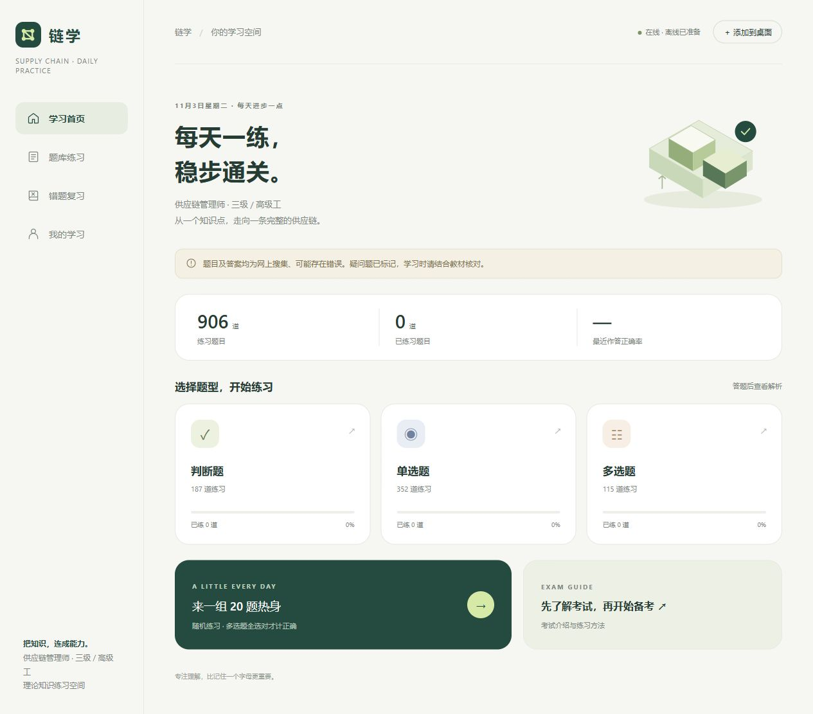

# 链学 · Lianxue

**供应链管理师三级 / 高级工备考练习工具**

把表格题库转化为手机上的「做题 → 查看解析 → 错题复习」流程。

## 在线体验

**[点击打开链学 →](https://lianxue.app.workbuddy.host/?sharecode=BTVZBKNRPV)**

请保留链接中的分享码；打开后可关闭欢迎提示进入练习。

## 产品截图

以下为 2026 年 11 月 3 日从线上产品截取的真实首页，展示无历史记录的初始状态。

## 为什么做

表格适合保存题目，但在手机上反复练习、核对答案和整理错题并不方便。链学从个人备考场景出发，将分散的题目、答案和解析整理为可交互的练习体验。

## 核心体验

| 环节 | 功能与目的 |
| --- | --- |
| 选择练习 | 按判断题、单选题、多选题分类进入 |
| 独立作答 | 提交后查看答案与解析，减少提前看到答案的干扰 |
| 巩固知识 | 通过错题复习与收藏回看需要加强的内容 |
| 识别不确定性 | 对存在争议的题目保留待核实提示 |
| 手机使用 | 采用适配手机的网页界面，降低使用门槛 |

## 关键设计取舍

- **先完成学习流程：** 优先打通练习、解析和复习。
- **保留轻量入口：** 当前产品选择使用首次提示弹窗，不增加激活码或设备绑定。
- **透明呈现内容边界：** 题目及答案来自网络搜集资料，可能存在错误；本工具不是官方题库，也不承诺考试结果。
- **区分理论与技能：** 本项目聚焦理论练习，不代替完整的考试准备。

## 我的工作

结合供应链领域经验定义需求，规划手机端练习流程与内容结构；借助 AI 协助代码实现、题目整理和解析补充，并通过测试与反馈持续修改产品。

AI 补充的解析仍需结合可靠资料核验，不能直接视为标准答案。

## 项目状态

个人产品，持续迭代与验证。本仓库用于作品展示，不公开完整题库和产品源码。线上体验入口与真实截图见上方。

[返回个人主页](https://github.com/lenecomeback-cmd)

